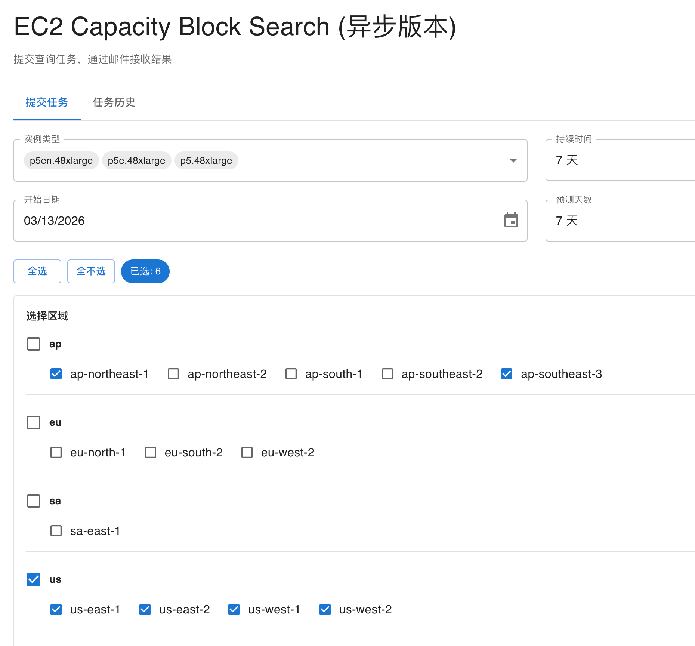
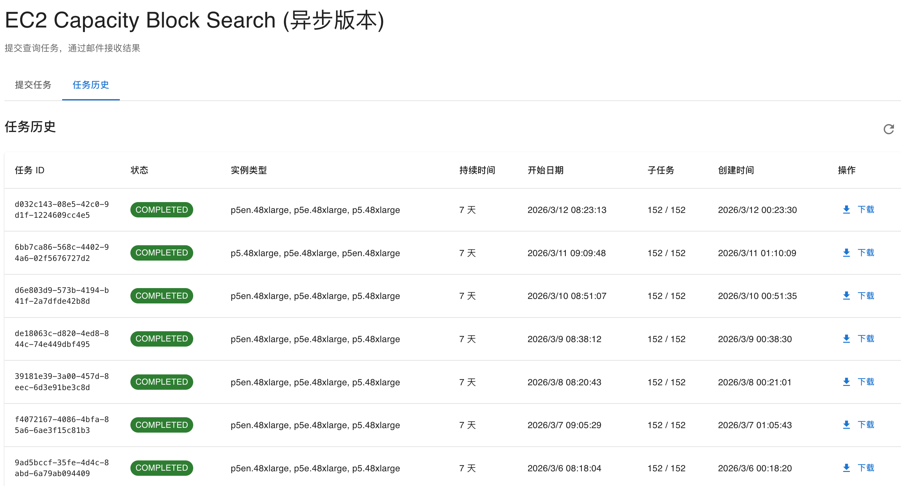

# EC2 Capacity Block Search

[English](README.en.md) | 中文

基于任务队列的异步 EC2 容量块查询系统

## 🎯 项目特点

- ✅ **异步任务处理**: 使用 Step Functions 编排长时间运行的查询
- ✅ **智能限流**: 每个 region 串行查询，避免 API throttling
- ✅ **二分查找**: 高效查找最大可用容量 (1-64 实例)
- ✅ **自动重试**: Throttling 错误自动重试 3 次
- ✅ **邮件通知**: 任务完成后通过 SNS 发送邮件
- ✅ **结果持久化**: CSV 文件存储在 S3，支持下载
- ✅ **任务历史**: 查看所有提交的任务及状态
- ✅ **机型自动发现**: 通过 EC2 API 自动发现**真正支持 Capacity Block** 的加速机型及区域，无需手工维护（部署时 + 每日定时刷新）
- ✅ **实时单价**: 每加速卡时价由真实 `UpfrontFee` 反算得出，无写死价格
- ✅ **任务取消**: 运行中/等待中的任务可随时取消（停止 Step Functions 执行，已完成结果保留，不生成 CSV）

## 📷 预览



通过控制台可以进行多区域、多实例类型、自定义时间维度的进行查询。



通过任务历史页面查看历史记录，并可随时进行下载。

## 🏗️ 架构

```
前端 (React)
    ↓
API Gateway (REST API + API Key)
    ↓
Lambda: SubmitTask
    ├─ 创建任务元数据 (DynamoDB)
    └─ 启动 Step Functions
        ↓
    Step Functions
        ├─ Map (Region 并发)
        │   └─ Map (子任务串行, 间隔 10 秒)
        │       └─ Lambda: QueryCapacity (二分查找)
        │           └─ 写入结果 (DynamoDB)
        ├─ Lambda: AggregateResults (生成 CSV → S3)
        └─ Lambda: SendNotification (SNS 邮件)
```

## 📊 数据流

1. **用户提交任务** → API Gateway → SubmitTask Lambda
2. **创建任务记录** → DynamoDB Tasks 表
3. **启动工作流** → Step Functions
4. **并发查询** → 多个 region 同时执行
5. **串行子任务** → 每个 region 内串行查询（避免 throttling）
6. **二分查找** → 1-64 实例数量的二分查找
7. **保存结果** → DynamoDB Results 表
8. **生成 CSV** → S3 Bucket
9. **发送通知** → SNS Topic → 邮件

## 🗂️ 项目结构

```
capacity_block_search_async/
├── backend/                    # Lambda 函数
│   ├── query_capacity.py      # 二分查找核心逻辑（多凭证池 + 限流轮换/失效转移）
│   ├── query_credentials.py    # 凭证池解析（SSM SecureString / env → 角色兜底），共享模块
│   ├── submit_task.py          # 提交任务（按账号数自动伸缩并发/等待）
│   ├── refresh_instance_types.py  # 通过 EC2 API 自动发现机型并刷新 SSM
│   ├── aggregate_results.py    # 聚合结果生成 CSV（单价由 UpfrontFee 反算）
│   ├── send_notification.py    # 发送邮件通知
│   ├── update_task_status.py   # 更新任务状态
│   ├── handle_failure.py       # 错误处理
│   ├── list_tasks.py           # 列出任务
│   ├── get_task_results.py     # 获取结果 URL
│   ├── cancel_task.py          # 取消任务（停止 Step Functions 执行）
│   └── requirements.txt
├── infrastructure/             # CDK 基础设施
│   ├── app.py                  # CDK 入口
│   ├── capacity_block_async_stack.py  # Stack 定义
│   ├── cdk.json
│   └── requirements.txt
├── frontend/                   # React 前端 (待实现)
│   └── src/
│       └── data/
│           └── instanceTypes.json  # 部署时的兜底种子；运行时由 EC2 API 自动刷新
└── README.md                   # 本文件
```

> 💡 **机型与价格均为动态**
> - 机型列表：`RefreshInstanceTypes` Lambda 在**部署时**（CDK Trigger）和**每天**（EventBridge）自动发现机型，写入 SSM Parameter；前端 `/config` 接口读取该参数。发现分两步：先用 `DescribeInstanceTypeOfferings` / `DescribeInstanceTypes` 找出各区域的 P/Trn 加速机型及加速卡规格，再用 `DescribeCapacityBlockOfferings` **逐 (机型, 区域) 校验是否真正支持 Capacity Block 购买**——只收录能 CB 购买的组合（自动排除 p3dn、trn1.2xlarge 等非 CB 机型，以及无 CB API 的区域；同一机型在不同区域的 CB 支持也不同，如 p4d 仅 us-east-1/us-east-2/us-west-2）。`instanceTypes.json` 仅作为发现失败时的兜底种子。有新机型上线时**无需改代码**。
> - 每加速卡时价：由 `describe_capacity_block_offerings` 返回的真实 `UpfrontFee` 反算 `UpfrontFee / (InstanceCount × acceleratorCount × DurationHours)`，无写死价格，不需额外 API 调用。

## 🚀 快速开始

### 前置条件

- AWS CLI 已配置
- Node.js 18+
- Python 3.12+（本地运行 CDK 用；Lambda 运行时为 Python 3.14）
- AWS CDK CLI: `npm install -g aws-cdk`
- 有效的 AWS 账户和权限

### 1. 部署后端

```bash
cd infrastructure
pip install -r requirements.txt
cdk bootstrap  # 首次部署
cdk deploy
```

部署完成后，记录以下输出值：
- `ApiEndpoint`: API Gateway URL
- `ApiKeyId`: API Key ID
- `SnsTopicArn`: SNS Topic ARN
- `ResultsBucketName`: S3 Bucket 名称
- `TasksTableName`: 任务表名称
- `ResultsTableName`: 结果表名称

### 2: 获取 API Key

```bash
# 使用 ApiKeyId 获取 API Key 值
aws apigateway get-api-key \
  --api-key <ApiKeyId> \
  --include-value \
  --query 'value' \
  --output text
```

记录这个 API Key 值，稍后配置前端时需要。

### 3. 配置 SNS 订阅

```bash
aws sns subscribe \
  --topic-arn <SnsTopicArn> \
  --protocol email \
  --notification-endpoint your@email.com
```

### 4. 前端本地测试和云端部署

请参考 [README.md](/frontend/README.md)

## ⚙️ 可选：自定义查询凭证（跨账号 / 扩展预订窗口）

`QueryCapacity` Lambda 默认使用**自身的执行角色**调用 EC2 `DescribeCapacityBlockOfferings`。若需要用**其他身份**查询（例如某账号拥有更长的 Capacity Block 预订窗口、或需跨账号查询），可为该 Lambda 配置查询凭证。

`DescribeCapacityBlockOfferings` 的限流是**按账号**计的——配置**多对凭证**可把调用分摊到多个账号各自独立的限流配额上，遇到限流时**立即轮换到下一对凭证重试**（而非长时间等待），从而显著加快查询。

**推荐：SSM SecureString 参数（单一真相源）**

创建名为 `/capacity-block-search/query-credentials` 的 **SecureString** 参数，值为 JSON 数组（由你自行创建/填充，栈不会创建它，避免密钥进入模板或 git）：
```json
[
  {"access_key_id": "<AK1>", "secret_access_key": "<SK1>"},
  {"access_key_id": "<AK2>", "secret_access_key": "<SK2>"}
]
```
```bash
aws ssm put-parameter --name /capacity-block-search/query-credentials \
  --type SecureString --value '[{"access_key_id":"...","secret_access_key":"..."}]' \
  --region <region>
```

凭证解析优先级：
1. SSM SecureString `/capacity-block-search/query-credentials`（推荐，多对）；
2. `EC2_QUERY_CREDENTIALS` 环境变量（JSON 数组，向后兼容）；
3. `EC2_QUERY_ACCESS_KEY_ID` / `EC2_QUERY_SECRET_ACCESS_KEY`（单对，向后兼容）；
4. 都未设置 → 回退到 Lambda 执行角色（默认）。

**自动按账号数伸缩**：`SubmitTask` 读取上面的凭证数 N，自动设置 Step Functions 的子任务**并发=min(N, 10)**、**子任务间等待=（N==1 ? 10s : 2s）**，注入执行输入（Map `MaxConcurrencyPath` / Wait `SecondsPath` 运行时读取）。账号越多 → 并发越高、等待越短 → 查询越快，无需手工调参（可用 `MAX_SUBTASK_CONCURRENCY` / `SINGLE_ACCT_WAIT_SECONDS` / `MULTI_ACCT_WAIT_SECONDS` 环境变量覆盖）。

其他说明：并发子任务按 `(region, 机型, 日期)` 散列选择**起始凭证**均衡负载；单次查询内遇限流在池中轮换。**若某对凭证不可用**（AK/SK 无效、账号待验证 `PendingVerification`、无权限），会被**自动剔除并转到下一对**，不会使查询失败（仅当全部不可用才报错）。栈默认**不设置**凭证，开箱即走执行角色。

> ⚠️ **切勿把真实 AK/SK 硬编码进代码或提交到仓库**（本仓库为公开的 aws-samples）。请用上面的 SSM SecureString（或 Secrets Manager）配置，并定期轮换。

## 🔒 安全建议

本示例的 API 仅使用 **API Key** 保护，而 API Key 会被打包进前端产物中（属公开信息，**不是身份认证手段**）。用于生产或对外访问前，强烈建议：

- **启用 AWS WAF**：为 API Gateway 和 / 或 Amplify 应用接入 WAF，限制来源、速率并拦截恶意流量。
- **前端启用登录（账号密码）**：若通过 **AWS Amplify Hosting** 部署前端，请开启 Amplify 的**访问控制（Access control，即用户名 / 密码 Basic Auth）**，避免页面及其内嵌的 API Key 被任何人公开访问。
- **为 API 增加真实鉴权**：如 Amazon Cognito、IAM 或 Lambda Authorizer，替代 / 补充 API Key。
- **收紧 CORS**：将 `allow_origins` 限制为你的前端域名，而非 `*`。
- **加固 S3 结果桶**：显式启用 Block Public Access、默认加密与 enforce SSL。

## ⚠️ 免责声明

本项目为**示例代码（Sample / Demo）**，仅用于演示与学习目的，按「**现状（AS IS）**」提供，不含任何明示或默示的担保。请勿在未经充分安全评估与加固的情况下直接用于生产环境。使用者须自行承担因使用本代码而产生的一切风险与费用（包括但不限于 AWS 资源费用、数据安全与合规责任）。本项目不代表 AWS 官方立场。

## Security

See [CONTRIBUTING](CONTRIBUTING.md#security-issue-notifications) for more information.

## License

This library is licensed under the MIT-0 License. See the LICENSE file.

